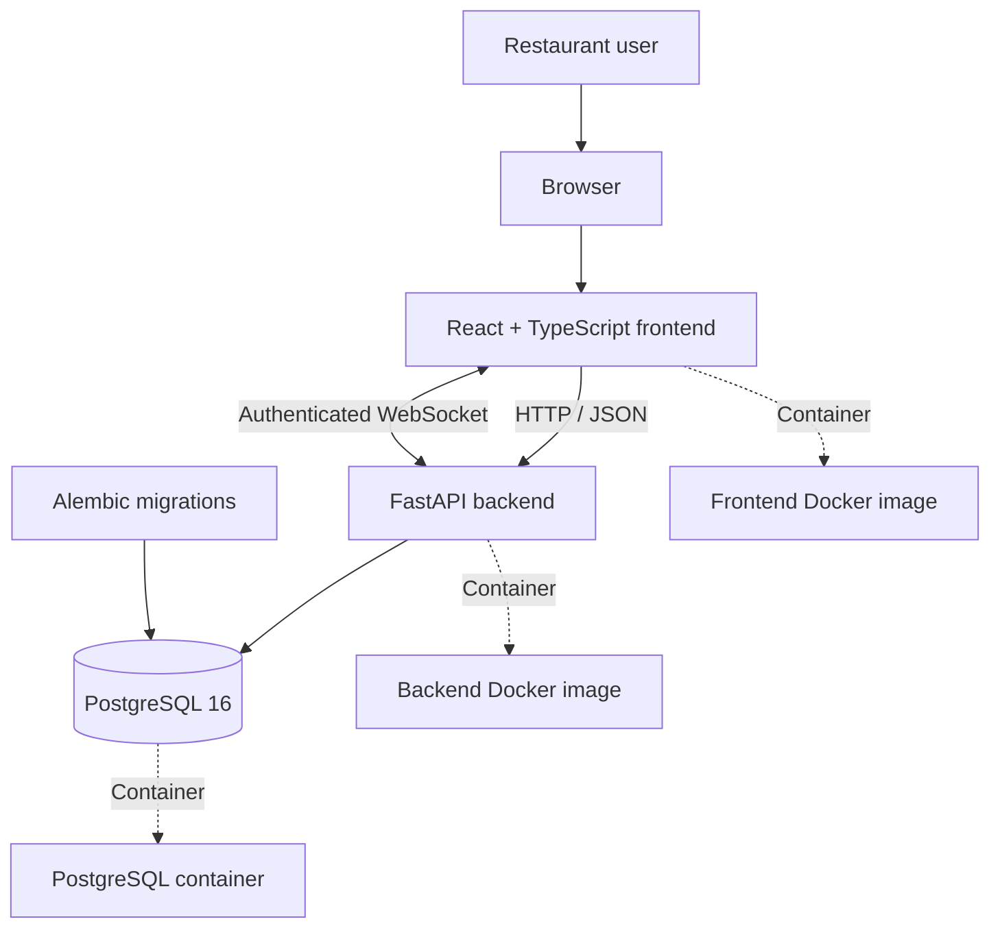

# SeatFlow Restaurant Waitlist

[](https://www.python.org/)
[](https://www.typescriptlang.org/)
[](https://fastapi.tiangolo.com/)
[](https://www.postgresql.org/)
[](https://docs.docker.com/compose/)

SeatFlow is a restaurant waitlist management application built with FastAPI, React, TypeScript, and PostgreSQL. It provides a web interface for restaurant staff to manage guest queues and monitor waitlist activity.

This repository is the final-project implementation for the **DataTalksClub AI Dev Tools Zoomcamp**. It demonstrates AI-assisted software development, frontend and backend integration, database persistence, containerized services, testing, and operational documentation.

> **Project status:** The project has a Docker Compose setup and has passed the local frontend lint/build checks and backend tests reported during verification. These local results do not, by themselves, prove a successful GitHub Actions run or public cloud deployment.

## Table of Contents

- [1. Problem and Motivation](#1-problem-and-motivation)
- [2. Project Goals and Intended Users](#2-project-goals-and-intended-users)
- [3. Key Features](#3-key-features)
- [4. Architecture](#4-architecture)
- [5. Technology Stack](#5-technology-stack)
- [6. Repository Structure](#6-repository-structure)
- [7. Prerequisites](#7-prerequisites)
- [8. Run with Docker Compose](#8-run-with-docker-compose)
- [9. Local Access URLs](#9-local-access-urls)
- [10. Configuration and Secrets](#10-configuration-and-secrets)
- [11. Main Workflows](#11-main-workflows)
- [12. API and Documentation](#12-api-and-documentation)
- [13. Database and Migrations](#13-database-and-migrations)
- [14. Testing and Quality Checks](#14-testing-and-quality-checks)
- [15. Troubleshooting](#15-troubleshooting)
- [16. AI-Assisted Development](#16-ai-assisted-development)
- [17. Agent Extension Pack](#17-agent-extension-pack)
- [18. Security, Testing, and DevOps](#18-security-testing-and-devops)
- [19. Deployment and CI/CD](#19-deployment-and-cicd)
- [20. Reproducibility Checklist](#20-reproducibility-checklist)
- [21. Limitations and Future Improvements](#21-limitations-and-future-improvements)
- [22. License and Acknowledgments](#22-license-and-acknowledgments)

---
## 1. Problem and Motivation

Restaurants need a practical way to organize waiting guests, track queue status, and reduce manual waitlist management. SeatFlow provides a centralized application for these tasks.

## 2. Project Goals and Intended Users

The project demonstrates a full-stack application with a REST API, a web dashboard, database persistence, authentication, and containerized development.
Key engineering goals include authenticated access, role-based authorization, restaurant-scoped waitlist operations, persistent relational data, a documented HTTP API, and real-time updates over WebSockets.

Intended users include restaurant owners and staff who manage guest waitlists.

## 3. Key Features

- User registration and login.
- Authenticated restaurant workspace.
- Waitlist entry management.
- Queue actions, including calling, seating, completing, cancelling, and marking guests as no-shows, where supported by the application.
- Waitlist statistics and dashboard refresh.
- Real-time waitlist updates through an authenticated WebSocket (/ws/waitlist), scoped by restaurant.
- PostgreSQL persistence.
- API documentation through FastAPI.
- Docker Compose development environment.
- Automated frontend and backend checks.

## 4. Architecture



## 5. Technology Stack

| Component | Technology |
|---|---|
| Frontend | React, TypeScript, Vite |
| Backend | Python, FastAPI |
| Database | PostgreSQL 16 |
| API schema | OpenAPI |
| Containers | Docker, Docker Compose |
| Frontend checks | ESLint, Vite build |
| Backend tests | pytest |
| Database migrations | Alembic, where configured |

## 6. Repository structure

The following is the **target structure** for the project:

```text
seatflow-restaurant-waitlist/
|-- README.md
|-- product-spec.md
|-- AGENTS.md
|-- openapi.yaml
|-- docker-compose.yml
|-- frontend/
|   |-- src/
|   |   |-- App.tsx
|   |   |-- api.ts
|   |   `-- ...
|   |-- package.json
|   `-- Dockerfile
|-- backend/
|   |-- app/
|   |   |-- api/
|   |   `-- ...
|   |-- tests/
|   |-- requirements.txt
|   |-- Dockerfile
|   `-- ...
|-- scripts/
|-- docs/
|-- security/
|-- ops/
|-- agent-capabilities/
|-- agent-hooks/
|-- mcp-server/
|-- plugins/
`-- .github/
    `-- workflows/
```

This is a **target structure**, not a guarantee that every listed path already exists. The actual repository inventory should be checked as the project evolves; update this tree when files or directories are added, removed, or renamed.

Important application files include:

- `frontend/src/App.tsx`: main application and dashboard composition.
- `frontend/src/api.ts`: centralized frontend API communication.
- `backend/app/`: FastAPI application and backend modules.
- `docker-compose.yml`: local multi-service configuration.
- `openapi.yaml`: checked-in API contract, if present.
- `product-spec.md` and `AGENTS.md`: requirements and AI-agent instructions, if present.

## 7. Prerequisites

Install the following before running the containerized application:

- Git
- Docker Desktop with Docker Compose
- A terminal such as PowerShell

For development outside Docker, install the compatible Python and Node.js versions required by the backend and frontend configuration.

## 8. Run with Docker Compose

Open PowerShell and navigate to the repository:

```powershell
Set-Location "C:\Users\kambar\seatflow-restaurant-waitlist"
```

Validate the Compose configuration:

```powershell
docker compose config
```

Build and start the services:

```powershell
docker compose up --build -d
```

Check service status:

```powershell
docker compose ps
```

Inspect application logs:

```powershell
docker compose logs --tail 100
```

Follow the logs:

```powershell
docker compose logs -f
```

Stop the services when finished:

```powershell
docker compose down
```

**Database warning:** Do not use `docker compose down -v` unless you intentionally want to remove the associated volumes. The PostgreSQL volume may contain persistent project data.

## 9. Local Access URLs

The configured local development ports are:

| Service | URL |
|---|---|
| Frontend | http://localhost:8080 |
| Backend health check | http://localhost:8002/health |
| API documentation | http://localhost:8002/docs |
| OpenAPI schema | http://localhost:8002/openapi.json |

These URLs assume the Compose port mappings are unchanged. Confirm the actual ports with `docker compose ps`.

## 10. Configuration and Secrets

Configure application settings using the environment variables and environment files expected by the project.

The backend includes startup validation for production-related settings, including the secret key and CORS origins.

Important practices:

- Never commit real credentials or production secrets.
- Use a unique, sufficiently strong secret key outside development.
- Configure explicit CORS origins for the deployed frontend.
- Keep local environment files out of version control.
- Verify that environment variable names match the application configuration.
- Do not reuse development credentials in production.

Consult the current application settings and Compose configuration for the exact variables required by each service.

## 11. Main Workflows

The application is intended to support these workflows:

1. Register or log in.
2. Access the restaurant workspace.
3. Add guests to the waitlist.
4. Update guest status using the available queue actions.
5. Refresh the waitlist and summary.
6. Review the dashboard statistics.

Actual behavior depends on the endpoints and controls implemented in the current version.

## 12. API and Documentation

FastAPI provides the backend REST API and its OpenAPI schema.

When the backend is running locally, visit:

- Swagger UI: `http://localhost:8002/docs`
- OpenAPI JSON: `http://localhost:8002/openapi.json`

Use the generated API documentation to inspect available routes, request schemas, response schemas, and authentication requirements.

## 13. Database and Migrations

SeatFlow uses PostgreSQL for persistent application data. Database schema changes should be managed through the project's migration workflow where configured.

Before applying migrations to an important environment:

- Confirm the database connection settings.
- Review pending migrations.
- Back up important data.
- Apply migrations using the project's configured procedure.
- Verify the resulting schema and application health.

Do not remove the PostgreSQL volume as a troubleshooting shortcut.

## 14. Testing and Quality Checks

Run checks from the appropriate project directories.

### Frontend

```powershell
Set-Location "$Repo\frontend"
npm run lint
npm run build
```

### Backend

```powershell
Set-Location $Repo
python -m pytest backend/tests -q
```

### Docker Compose

```powershell
Set-Location $Repo
docker compose config
docker compose ps
```

Use the project's configured Python environment and installed dependencies when running backend tests. A successful test run verifies the tested behavior, not every possible production scenario.

## 15. Troubleshooting

### Frontend cannot reach the API

- Confirm the backend container is running.
- Check the frontend API base URL and Compose port mappings.
- Inspect browser developer tools for failed network requests.
- Review backend logs for request errors.

### Backend fails to start

```powershell
docker compose logs --tail 200
```

Check required environment variables, database connectivity, and application startup validation.

### Database connection problems

```powershell
docker compose ps
docker compose logs --tail 100
```

Confirm that PostgreSQL is healthy and the backend uses the correct database hostname and port for its execution environment.

### Dashboard data does not refresh

- Inspect the browser Network panel.
- Confirm the waitlist and statistics requests return successful responses.
- Check the response bodies for updated data.
- Review browser console errors and backend logs.
- Verify that the frontend refresh logic updates its displayed state.

### Port conflicts

Check which ports are mapped by Docker Compose and whether another service is using them before changing configuration.

## 16. AI-Assisted Development

AI-assisted development tools may be used to support implementation, debugging, testing, and documentation.

AI-generated code and recommendations should be reviewed and verified. Record actual tools and contributions accurately, and do not present suggested or generated artifacts as independently validated results without evidence.

## 17. Agent Extension Pack

The repository includes a `custom-agent/` documentation area for agent-related project material.

Documentation, templates, or scaffolding do not by themselves establish that an agent is integrated into the runtime. Verify implementation, configuration, and tests before describing an extension as operational.

## 18. Security, Testing, and DevOps

Security and operational practices to maintain include:

- Secret management through environment configuration.
- Authentication and authorization checks.
- Input validation and appropriate error handling.
- Explicit CORS configuration.
- Automated tests and linting.
- Dependency maintenance.
- Database backups and migration review.
- Container and deployment configuration review.

A passing local test suite is not equivalent to a complete security audit. Claims about security reviews, continuous integration, monitoring, or deployment should be supported by actual configured workflows and evidence.

## 19. Deployment and CI/CD

The Docker Compose configuration supports local containerized development and verification.

Before deploying to a hosted environment, configure production secrets, database persistence and backups, HTTPS, allowed origins, logging, health checks, and an appropriate hosting architecture.

Configure CI/CD to run the project's relevant tests and build checks before deployment. Do not assume automated deployment or cloud hosting is configured unless the repository contains and verifies those workflows.

## 20. Reproducibility Checklist

Before presenting or submitting the project, verify:

- [ ] Repository dependencies are documented.
- [ ] Environment configuration is understood.
- [ ] Docker Compose configuration validates.
- [ ] Frontend linting passes.
- [ ] Frontend production build passes.
- [ ] Backend tests pass.
- [ ] Database persistence is verified.
- [ ] Health and API endpoints respond as expected.
- [ ] Authentication and core waitlist workflows are tested.
- [ ] README instructions match the current implementation.
- [ ] Secrets and local environment files are not committed.
- [ ] Git status and the final commit are reviewed.

## 21. Limitations and Future Improvements

Potential areas for further work include:

- More comprehensive integration and end-to-end tests.
- Additional role-based access controls.
- Improved observability and structured logging.
- Production deployment automation.
- Backup and recovery procedures.
- Expanded API and user documentation.
- Additional usability and accessibility testing.

These are potential improvements, not claims that the features are already implemented.

## 22. License and Acknowledgments

Refer to the repository's license file for the applicable licensing terms. If no license file exists, confirm the intended license before distributing the project.

Thanks to the maintainers, contributors, and tools that support the development and testing of SeatFlow.

## MCP Server and Agent Extension Pack

SeatFlow includes a local, read-only Model Context Protocol (MCP) server and an agent extension pack to support repository review, approved documentation access, and project-specific guardrails.

### MCP Tools

The local MCP server exposes two tools:

- `review_repository_structure` — checks selected repository structure and project configuration requirements, including required files, API paths, and Docker Compose services.
- `read_approved_project_document` — reads documentation explicitly permitted by the server's allowlist.

These tools support development and review. A successful structural review does not replace application tests, live API checks, or a complete security audit.

### Security Boundaries

The documentation-reading tool uses an explicit allowlist. It rejects unapproved documents, absolute paths, parent-directory traversal, missing files, and files exceeding the configured 200,000-byte limit.

The MCP server is intended for local, read-only repository assistance. Its documented tools do not provide general-purpose file-writing, shell-execution, or database-mutation capabilities.

### Agent Extension Pack

The extension pack includes:

- A repository review capability and tests.
- Agent guardrails and tests.
- A custom agent instruction file.
- MCP server implementation, documentation, and smoke tests.
- Permission and security documentation.

See `docs/agent-extension-pack.md` for the extension-pack overview, `docs/permissions.md` for permission boundaries, and `mcp-server/README.md` for MCP-specific instructions.

### Local MCP Setup

The MCP server uses a dedicated Python virtual environment and the MCP Python SDK. In the development environment, the VS Code user MCP configuration is located at:

`%APPDATA%\Code\User\mcp.json`

The configuration registers the local `seatflow` server alongside the existing MCP servers. Keep existing server entries intact when updating the configuration. The local server runs through the dedicated Python executable and `mcp-server/server.py`.

After changing the MCP configuration, restart or reload the relevant VS Code MCP session and confirm that the `seatflow` server starts and discovers its two tools.

### Validation

The completed development checks included:

- MCP core unit tests: 6 passed.
- Repository review capability: 3 tests passed.
- Agent guardrail tests: 4 passed.
- MCP smoke test: passed.
- Repository structure review: 19 checks passed, with no failures or errors.
- Full backend test suite: 47 passed.
- Frontend lint and production build: passed.
- Docker Compose configuration validation: passed.
- HTTP smoke checks: `/health` and `/openapi.json` on port `8002`, and the frontend on port `8080`, returned HTTP 200.

These are recorded development-validation results, not a claim that every possible security or production scenario has been tested.

### Relevant Files

- `mcp-server/server.py`
- `mcp-server/seatflow_mcp_core.py`
- `mcp-server/test_seatflow_mcp_core.py`
- `mcp-server/smoke_test_mcp.py`
- `agent-capabilities/`
- `agent-hooks/`
- `custom-agent/AGENT.md`
- `docs/agent-extension-pack.md`
- `docs/permissions.md`
