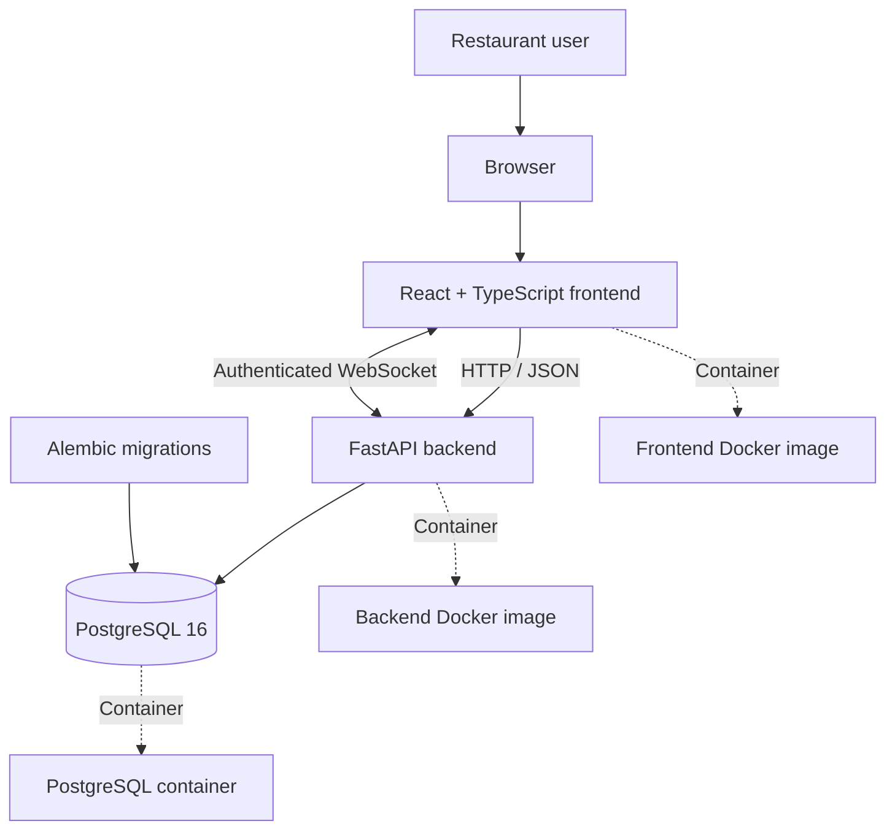

# SeatFlow — Restaurant Waitlist Management System

[](https://www.python.org/)
[](https://www.typescriptlang.org/)
[](https://fastapi.tiangolo.com/)
[](https://www.postgresql.org/)
[](https://docs.docker.com/compose/)

**SeatFlow** is a full-stack restaurant waitlist management application built to help restaurant teams organize guest queues, track service progress, and monitor waitlist activity through a centralized dashboard.

This repository is the final-project implementation for the DataTalksClub AI Dev Tools Zoomcamp. It brings together AI-assisted software development, a typed frontend, a documented API, persistent database storage, containerized services, testing, and security and operational documentation.

> **Project status:** The application has a Docker Compose setup and has previously passed frontend lint/build checks and backend health checks. See the verification and evidence sections below. A passing local check is not, by itself, proof of public cloud deployment or a complete CI/CD pipeline.

## Table of contents

- [1. Problem and motivation](#1-problem-and-motivation)
- [2. Goals and intended users](#2-goals-and-intended-users)
- [3. Features](#3-features)
- [4. Architecture](#4-architecture)
- [5. Technology stack](#5-technology-stack)
- [6. Repository structure](#6-repository-structure)
- [7. Prerequisites](#7-prerequisites)
- [8. Run with Docker Compose](#8-run-with-docker-compose)
- [9. Access the application](#9-access-the-application)
- [10. Configuration and secrets](#10-configuration-and-secrets)
- [11. Application workflows](#11-application-workflows)
- [12. API and OpenAPI contract](#12-api-and-openapi-contract)
- [13. Database and migrations](#13-database-and-migrations)
- [14. Run tests and quality checks](#14-run-tests-and-quality-checks)
- [15. Troubleshooting](#15-troubleshooting)
- [16. AI-assisted development workflow](#16-ai-assisted-development-workflow)
- [17. Agent extension pack](#17-agent-extension-pack)
- [18. Security, audit, and DevOps](#18-security-audit-and-devops)
- [19. Deployment and CI/CD](#19-deployment-and-cicd)
- [20. Reproducibility checklist](#20-reproducibility-checklist)
- [21. Limitations and future improvements](#21-limitations-and-future-improvements)
- [22. License and acknowledgments](#22-license-and-acknowledgments)

---

## 1. Problem and motivation

Restaurants need a reliable way to coordinate guests who are waiting for a table. When queue information is maintained informally or across disconnected tools, staff can lose track of guest status, duplicate updates, and struggle to understand current demand.

SeatFlow provides a centralized waitlist workflow. Authorized restaurant users can manage guest entries, advance parties through service states, and review statistics without maintaining separate manual records.

The project also demonstrates an end-to-end software engineering workflow: defining requirements, implementing frontend and backend components, integrating a persistent database, documenting the API, running the application in containers, and validating changes.

## 2. Goals and intended users

### Intended users

- **Restaurant owners:** configure and manage their restaurant workspace.
- **Managers:** coordinate waitlist operations and oversee service activity.
- **Staff:** perform the waitlist actions permitted by their assigned role.

Exact permissions must follow the backend authorization implementation, not merely the labels displayed in the frontend.

### Project goals

1. Provide a clear dashboard for restaurant waitlist operations.
2. Implement authenticated access and role-based authorization.
3. Isolate restaurant data between tenants.
4. Persist restaurant, user, and waitlist records in a relational database.
5. Expose structured HTTP API endpoints and a real-time WebSocket channel.
6. Run the application and database using Docker Compose.
7. Document tests, AI-assisted development decisions, security controls, and reproducible setup steps.

## 3. Features

The implemented application has been developed around the following capabilities. Each should be reverified against the current source before a formal project submission.

| Capability | Purpose |
|---|---|
| User authentication | Register or log in users and authenticate protected requests. |
| Password protection | Use password hashing rather than storing plaintext passwords. |
| Role-based access control | Restrict actions according to user permissions. |
| Restaurant tenant isolation | Scope access to the user's authorized restaurant. |
| Waitlist management | Add and retrieve guest parties and manage their status. |
| Queue operations | Support actions such as calling, seating, cancellation, and marking no-shows. |
| Statistics dashboard | Display counts and summaries for waitlist activity. |
| Real-time updates | Provide an authenticated WebSocket endpoint for waitlist events. |
| Database migrations | Apply schema changes through Alembic. |
| Containerized runtime | Run the frontend, backend, and PostgreSQL using Docker Compose. |

The application should return useful errors for invalid input, unauthenticated requests, unauthorized actions, missing records, and database or service failures. Actual response behavior should be verified through API tests.

## 4. Architecture



### Request flow

1. A user opens the frontend in a browser.
2. The frontend sends API requests to FastAPI.
3. The backend authenticates the request and checks applicable authorization rules.
4. Database operations read or update the appropriate restaurant and waitlist records.
5. The backend returns structured responses to the frontend.
6. The WebSocket connection can support live waitlist updates when the connection is authenticated and functioning.

Docker Compose coordinates the application services and database. Alembic manages database schema revisions.

## 5. Technology stack

| Technology | Responsibility |
|---|---|
| React | Component-based user interface. |
| TypeScript | Static type checking for frontend code. |
| Vite | Frontend development server and production build. |
| FastAPI | Backend HTTP API and API documentation. |
| Pydantic | Request and response data validation. |
| SQLAlchemy | Relational database access. |
| PostgreSQL 16 | Persistent relational storage in the containerized setup. |
| Alembic | Versioned database schema migrations. |
| JWT | Token-based authentication. |
| Argon2 password hashing | Password storage protection. |
| WebSockets | Real-time communication channel. |
| Docker | Container images and isolated runtime services. |
| Docker Compose | Multi-service orchestration for local development. |
| pytest and HTTPX | Backend test and HTTP testing tools, where configured. |
| Git and GitHub | Source control and project collaboration. |

The repository's dependency files are the authoritative source for exact package versions. Do not infer production compatibility from a badge or from a developer's local Python version alone.

## 6. Repository structure

The expected high-level structure is:

```text
seatflow-restaurant-waitlist/
├── README.md
├── product-spec.md
├── AGENTS.md
├── openapi.yaml
├── docker-compose.yml
├── frontend/
│   ├── src/
│   │   ├── App.tsx
│   │   ├── api.ts
│   │   └── ...
│   ├── package.json
│   └── Dockerfile
├── backend/
│   ├── app/
│   │   ├── api/
│   │   ├── ...
│   ├── tests/
│   ├── requirements.txt
│   ├── Dockerfile
│   └── ...
├── scripts/
├── docs/
├── security/
├── ops/
├── agent-capabilities/
├── agent-hooks/
├── mcp-server/
├── plugins/
└── .github/
    └── workflows/
```

This is a **target structure**, not a guarantee that every listed path already exists. The generator prints a real file inventory after writing this README. Add or rename entries here to match the actual repository as it evolves.

Important application files include:

- `frontend/src/App.tsx` — main application and dashboard composition.
- `frontend/src/api.ts` — centralized frontend API communication.
- `backend/app/` — FastAPI application and backend modules.
- `docker-compose.yml` — local multi-service configuration.
- `openapi.yaml` — checked-in API contract, if present.
- `product-spec.md` and `AGENTS.md` — requirements and AI-agent instructions, if present.

## 7. Prerequisites

Install the following on your development machine:

1. Git.
2. Docker Desktop with Docker Compose support.
3. Python for running repository automation scripts and local backend tooling.
4. Node.js and npm if running frontend checks outside Docker.
5. A code editor such as Visual Studio Code.

Verify the available tools in PowerShell:

```powershell
git --version
docker --version
docker compose version
python --version
node --version
npm --version
```

Node.js and npm are not required on the host solely to use a frontend image that is already built by Docker.

## 8. Run with Docker Compose

### Step 1 — Open the project

```powershell
Set-Location "C:\Users\kambar\seatflow-restaurant-waitlist"
```

For another machine, clone the repository first and change into the cloned directory.

### Step 2 — Inspect configuration

```powershell
Get-ChildItem -Force
Get-Content .\docker-compose.yml
```

If `.env.example` exists, read it before creating a local environment file:

```powershell
if (Test-Path .\.env.example) {
    Get-Content .\.env.example
}
```

Use the variable names and instructions required by the actual configuration. Do not copy real credentials into Git.

### Step 3 — Build and start the services

```powershell
docker compose config --quiet
if ($LASTEXITCODE -ne 0) {
    throw "Docker Compose configuration validation failed."
}

docker compose up --build -d
if ($LASTEXITCODE -ne 0) {
    throw "Docker Compose failed to start."
}
```

The known local configuration maps the frontend to port `8080`, the backend to port `8002`, and PostgreSQL to a containerized service. Check the Compose file before assuming these mappings are unchanged.

### Step 4 — Check service status

```powershell
docker compose ps
```

Wait for the database health check to pass if one is configured. A running container is not necessarily a healthy or fully initialized application.

### Step 5 — Check the backend

```powershell
Invoke-RestMethod "http://localhost:8002/health"
```

The previously verified health response was:

```json
{
  "status": "ok",
  "service": "seatflow-api"
}
```

If the health endpoint or port changes, use the current Compose configuration and backend routes as the source of truth.

### Step 6 — Open the frontend

```powershell
Start-Process "http://localhost:8080"
```

Sign in using a locally provisioned test account. Do not publish example credentials or real JWT tokens in this README.

### Step 7 — Inspect logs

```powershell
docker compose logs --tail 100 backend
docker compose logs --tail 100 frontend
docker compose logs --tail 100 postgres
```

The service names above match the expected Compose setup; verify them with `docker compose ps` if your configuration differs.

### Step 8 — Stop the application

To stop containers while preserving database volumes:

```powershell
docker compose down
```

This does not intentionally remove named volumes. **Do not use `docker compose down -v`** unless you explicitly intend to delete the Compose-managed volumes and their persistent database contents.

To restart later:

```powershell
docker compose up -d
docker compose ps
```

## 9. Access the application

With the currently verified local port mappings:

| Service | Local URL | Purpose |
|---|---|---|
| Frontend | `http://localhost:8080` | Restaurant waitlist dashboard. |
| Backend health | `http://localhost:8002/health` | Basic backend health response. |
| FastAPI Swagger UI | `http://localhost:8002/docs` | Interactive API documentation, if enabled. |
| FastAPI ReDoc | `http://localhost:8002/redoc` | Alternative API documentation, if enabled. |
| OpenAPI JSON | `http://localhost:8002/openapi.json` | Generated API schema, if enabled. |

A local URL is not a public deployment URL. Add a public URL here only after deploying and verifying the application.

## 10. Configuration and secrets

Configuration should be environment-specific. Keep development, test, and deployment credentials separate.

Recommended practices:

- Keep real passwords, signing keys, database credentials, and API tokens out of source control.
- Commit a sanitized `.env.example` with variable names and safe placeholder values.
- Validate required configuration at application startup.
- Use a strong, unique signing secret outside development.
- Restrict database access to the required services.
- Use a persistent database volume for local data that must survive container recreation.
- Use managed secrets or protected environment variables in deployment.
- Rotate any credential accidentally exposed in logs, screenshots, commits, or chat.

Before submitting, confirm that `.gitignore` excludes actual environment files and that no secrets have been committed.

## 11. Application workflows

### Authentication

1. A user registers or signs in.
2. The backend verifies credentials and issues the configured authentication token.
3. The frontend includes the token in protected API requests.
4. The backend validates the token and applies user and restaurant authorization.
5. Logging out clears the client-side authentication state.

Authentication and authorization are separate concerns: a valid token must not grant access to another restaurant's records.

### Waitlist operations

The dashboard is designed to display guest queue entries and their current service statuses. Depending on the configured workflow, staff can add parties and perform actions such as calling, seating, cancelling, or marking a party as a no-show.

### Statistics and refresh

The frontend obtains waitlist entries and dashboard statistics through API requests. A successful refresh should update the displayed data from backend responses, not merely change the button state.

### Real-time updates

The frontend can open an authenticated WebSocket to the backend's waitlist endpoint. The connection must use the correct API host and authentication method. Reconnection behavior, handshake failures, authorization errors, and message handling should be covered by targeted verification.

## 12. API and OpenAPI contract

FastAPI provides an API schema from the implemented routes. The checked-in `openapi.yaml`, if present, should be treated as a versioned contract and compared with the live schema.

The API contract should document:

- Endpoint paths and HTTP methods.
- Request parameters and JSON schemas.
- Response schemas and status codes.
- Authentication requirements.
- Authorization and tenant-scoping expectations.
- Validation and error responses.
- Statistics and waitlist operations.
- WebSocket behavior in supplementary documentation, because the standard OpenAPI schema does not fully describe WebSocket message flows.

### Contract validation

Inspect the available files:

```powershell
Test-Path .\openapi.yaml
Invoke-RestMethod "http://localhost:8002/openapi.json" |
    ConvertTo-Json -Depth 20 |
    Set-Content -Encoding utf8 .\openapi-local-inspection.json
```

The generated local inspection file is for comparison, not automatically the canonical contract. Do not commit it unless it is intentionally part of your project artifacts.

Before submission, verify that the checked-in schema reflects the actual API paths, request and response models, security requirements, and frontend usage.

## 13. Database and migrations

The containerized setup uses PostgreSQL 16 and SQLAlchemy, with Alembic for versioned schema migrations.

The previously verified schema included:

- `restaurants`
- `users`
- `waitlist_entries`
- `alembic_version`

The initial migration revision previously reported by the project was `6fd61589df5c`. Confirm the current migration head against the repository before relying on this identifier.

### Database verification

```powershell
docker compose ps
docker compose logs --tail 100 postgres
docker compose logs --tail 100 backend
```

If Alembic is installed in the backend environment, inspect the current revision using the project's configured migration command. For example:

```powershell
docker compose exec backend alembic current
docker compose exec backend alembic heads
```

These commands assume the backend container has the Alembic CLI and the appropriate configuration.

### Database design expectations

- Use migrations to make schema changes reproducible.
- Keep database credentials out of source code.
- Test persistence across application restarts.
- Verify tenant isolation at the backend/database-access layer.
- Back up persistent data before destructive migration or volume operations.
- Test migrations on a disposable database before applying them to important data.

## 14. Run tests and quality checks

Testing should cover frontend behavior, backend logic, API integration, and the combined application.

### Frontend lint

```powershell
Set-Location "C:\Users\kambar\seatflow-restaurant-waitlist\frontend"
npm run lint
if ($LASTEXITCODE -ne 0) {
    throw "Frontend lint failed."
}
```

### Frontend production build

```powershell
npm run build
if ($LASTEXITCODE -ne 0) {
    throw "Frontend build failed."
}
```

The project previously passed these frontend checks after the dashboard and callback changes. Run them again on the final submission commit.

### Backend tests

Return to the repository root:

```powershell
Set-Location "C:\Users\kambar\seatflow-restaurant-waitlist"
```

If pytest is installed in the backend container and its tests are present:

```powershell
docker compose exec backend python -m pytest -q
```

If the repository instead uses a local virtual environment, activate that environment and follow the backend's dependency and test configuration.

Do not report a test count without capturing the output from the current revision.

### Integration checks

Verify the following against a running local stack:

1. The frontend loads.
2. Authentication succeeds with a valid test account.
3. Invalid or missing credentials are rejected by protected endpoints.
4. A guest party can be created and retrieved.
5. Permitted waitlist status transitions work.
6. Statistics agree with the underlying waitlist records.
7. Data persists after an application restart.
8. One restaurant cannot read or modify another restaurant's records.
9. The WebSocket handshake and message flow work with a valid token.
10. Unauthorized WebSocket requests are rejected.
11. The application reports meaningful errors when dependencies are unavailable.

Separate unit tests from integration tests. Document which tests require a live database, containers, or additional services.

## 15. Troubleshooting

### Frontend is unavailable

```powershell
docker compose ps
docker compose logs --tail 100 frontend
```

Confirm that port `8080` is available and that the frontend container is healthy.

### Backend health check fails

```powershell
docker compose logs --tail 150 backend
docker compose logs --tail 100 postgres
```

Check the backend startup logs, database connection configuration, migration state, and port `8002` mapping.

### Refresh does not update statistics

Open the browser developer tools, select **Network**, and click Refresh. Inspect the waitlist and statistics requests separately.

Confirm:

- The requests are sent to the intended backend.
- Both responses have successful status codes.
- The returned data contains the expected values.
- The frontend maps response fields to the displayed counts correctly.
- No stale frontend bundle or caching issue is involved.

A successful HTTP response alone does not prove the UI is displaying the correct data.

### WebSocket handshake fails

Inspect the WebSocket request in the browser Network panel and the corresponding backend logs. Check the endpoint path, host, authentication token, user authorization, and handshake response.

Do not paste JWTs or other secrets into issue reports. Redact credentials before sharing logs.

### Database data appears to be missing

Check which Compose project and database volume are active. Recreating a container is not the same as deleting a volume. Avoid destructive cleanup commands until the active database and backup state are understood.

## 16. AI-assisted development workflow

AI assistance is part of the development process, but generated code must be reviewed and tested by the developer.

A reproducible AI-assisted workflow should follow these steps:

1. **Define the task.** State the user problem, acceptance criteria, affected files, and constraints.
2. **Provide project context.** Use `product-spec.md`, `AGENTS.md`, architecture notes, and the OpenAPI contract where available.
3. **Ask for a focused change.** Request the smallest coherent implementation instead of an uncontrolled rewrite.
4. **Review the proposed solution.** Inspect the diff for security, authorization, tenant isolation, database behavior, and regressions.
5. **Run deterministic checks.** Execute linting, type checking, builds, tests, and relevant integration checks.
6. **Inspect runtime behavior.** Verify API responses, UI state, database persistence, and logs.
7. **Document the outcome.** Record the change, tests, known limitations, and any follow-up work.
8. **Commit a coherent change.** Preserve backups where appropriate and keep unrelated files out of the commit.

### AI usage record

For the final submission, maintain `docs/ai-usage-report.md` with entries containing:

| Field | What to record |
|---|---|
| Task | The problem being addressed. |
| Tool | The AI assistant or development tool used. |
| Context | Files, requirements, and constraints provided. |
| Prompt or delegation | The essential instruction given to the tool. |
| Proposed changes | What the AI suggested or generated. |
| Human review | What was checked, corrected, or rejected. |
| Verification | Commands run and observed results. |
| Outcome | Accepted change, limitation, or follow-up task. |

Do not claim that AI-generated output was independently verified unless the corresponding checks were actually run.

## 17. Agent extension pack

The 2026 course draft describes an additional extension pack for Module 5. The complete submission should provide concrete, reusable artifacts, not only a paragraph about agents.

The expected deliverables include:

| Artifact | Expected purpose |
|---|---|
| `AGENTS.md` | Project-specific instructions, conventions, constraints, and verification steps. |
| `agent-capabilities/` | Reusable task capabilities or documented workflows. |
| `agent-hooks/` | Automated guardrails for risky actions or validation. |
| `mcp-server/` | An MCP server exposing narrowly scoped, documented tools. |
| `plugins/` or `custom-agent/` | Plugin or specialist-agent implementation, if selected. |
| `docs/agent-extension-pack.md` | Architecture, installation, usage, and verification guide. |
| `docs/permissions.md` | Tool permissions, access boundaries, and approval rules. |

### Suggested SeatFlow specialist

A SeatFlow review specialist could inspect changes involving waitlist transitions, tenant isolation, authentication, API-contract alignment, and test coverage.

Its output should identify the affected files, risks, recommended tests, and whether required verification passed. It should not claim tests passed without execution evidence.

### Extension-pack safety expectations

- Grant tools the minimum permissions necessary.
- Require approval for destructive database operations and production changes.
- Avoid exposing secrets in prompts, tool output, or logs.
- Validate tool inputs and reject unexpected arguments.
- Keep MCP tools narrowly scoped and document their side effects.
- Use hooks or deterministic checks to prevent known unsafe operations.
- Include reproducible examples and tests for the extension itself.

If the extension pack is not yet implemented, mark it as pending rather than representing the planned design as completed work.

## 18. Security, audit, and DevOps

Security and operational evidence should be committed as reviewable project artifacts.

### Application security

Review at minimum:

- Authentication and password hashing.
- JWT signing, expiration, and validation.
- Role-based authorization on protected operations.
- Restaurant tenant isolation.
- Input validation and safe error handling.
- Database connection and secret management.
- WebSocket authentication and authorization.
- Dependency vulnerabilities.
- Container permissions and image configuration.
- Logging practices that prevent credentials and personal data from leaking.

### Audit artifacts

The course draft asks for evidence of security and operational review. A useful structure is:

```text
security/
├── README.md
├── threat-model.md
├── dependency-audit.md
├── security-scan-results.md
├── ai-tool-data-policy.md
└── findings/
```

```text
ops/
├── README.md
├── runbook.md
├── health-checks.md
├── incident-diagnosis.md
└── backup-restore.md
```

These are recommended artifact names, not proof that the files already exist. Include real outputs, scan dates, tool versions, findings, severity, remediation, and any accepted residual risks.

### Operational readiness

Document how to:

- Check service health and container status.
- Read relevant logs.
- Diagnose database connection failures.
- Identify migration problems.
- Verify refresh and WebSocket behavior.
- Back up and restore persistent data.
- Roll back a problematic release.
- Rotate credentials following an exposure.

Do not include live secrets, unredacted authentication tokens, or private customer data in audit artifacts.

## 19. Deployment and CI/CD

### Local versus cloud deployment

Docker Compose provides a reproducible local runtime. It does not, by itself, establish that the project has been deployed to the cloud.

For a cloud deployment, document:

- The public application URL.
- The deployment platform and date.
- Backend and database hosting.
- Required environment variables and secret configuration.
- HTTPS and WebSocket connectivity.
- Migration strategy.
- Health checks and rollback process.
- Evidence that the deployed version works.

Add a public URL only after verifying that it is accessible and represents the intended application.

### Continuous integration

The expected CI pipeline should run appropriate checks on proposed changes. A practical sequence is:

1. Check out the repository.
2. Install pinned or lockfile-defined dependencies.
3. Lint and build the frontend.
4. Run backend unit tests.
5. Run API and integration tests where configured.
6. Validate the OpenAPI contract.
7. Run applicable dependency and security scans.
8. Build container images.
9. Publish test results and security findings.

### Continuous deployment

If automated deployment is implemented, it should occur only after required checks pass. Protect deployment credentials and production environments, and make release failures diagnosable.

The existence of a `.github/workflows/` directory is not enough to prove that CI/CD works. Include workflow files, successful run evidence, and a verified deployment result.

## 20. Reproducibility checklist

Before submitting SeatFlow for peer review, verify every applicable item.

- [ ] README describes the problem, system behavior, and intended users.
- [ ] Product requirements and project instructions are included.
- [ ] Frontend and backend architecture are documented.
- [ ] Frontend API calls are centralized and core behavior is tested.
- [ ] OpenAPI specification matches the actual backend.
- [ ] Backend tests cover core functionality and authorization.
- [ ] Database setup and migrations are documented.
- [ ] Docker Compose can start the complete local application.
- [ ] Integration tests cover important end-to-end workflows.
- [ ] Public deployment URL or explicitly accepted deployment evidence is included.
- [ ] CI workflow executes required tests and reports results.
- [ ] Agent extension pack includes the required implementation and documentation, if applicable.
- [ ] Security scans, audit results, operational diagnosis, and AI data policy are recorded.
- [ ] A new developer can set up, run, test, and troubleshoot the application.
- [ ] Peer reviews of other projects are completed according to the final course rules.

The course criteria are currently a draft. Recheck the official requirements before submission, and distinguish verified evidence from planned improvements.

## 21. Limitations and future improvements

Potential improvements should be prioritized based on observed gaps:

- Expand automated frontend and integration test coverage.
- Add contract-drift checks between the OpenAPI file and the running backend.
- Add robust WebSocket reconnect, authorization, and message-flow tests.
- Add documented database backup and restore procedures.
- Automate dependency, container, and configuration security checks.
- Complete the agent extension pack and permission documentation.
- Publish a verified cloud deployment and reproducible release workflow.
- Improve accessibility, error states, and operational observability.

Only list an item as a remaining limitation if it is actually missing or insufficient in the current implementation.

## 22. License and acknowledgments

Specify the project's license in a `LICENSE` file before describing the repository as open source. Until a license is selected and committed, reuse and redistribution permissions should not be assumed.

Acknowledgments: DataTalksClub AI Dev Tools Zoomcamp and the open-source technologies used to build and test SeatFlow.

---

## Project evidence and verification

The README is a living project document. Before submission, keep the claims above consistent with the actual source code, test results, CI runs, deployment state, and extension-pack artifacts.

The repository inventory generated alongside this README lists selected paths that exist at generation time. It is a file-presence check, not a substitute for code review or a successful execution of the application.
